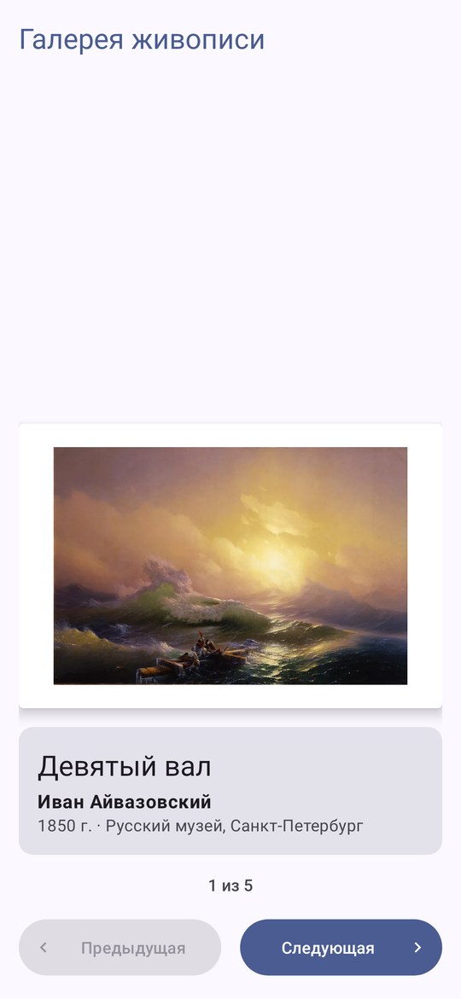
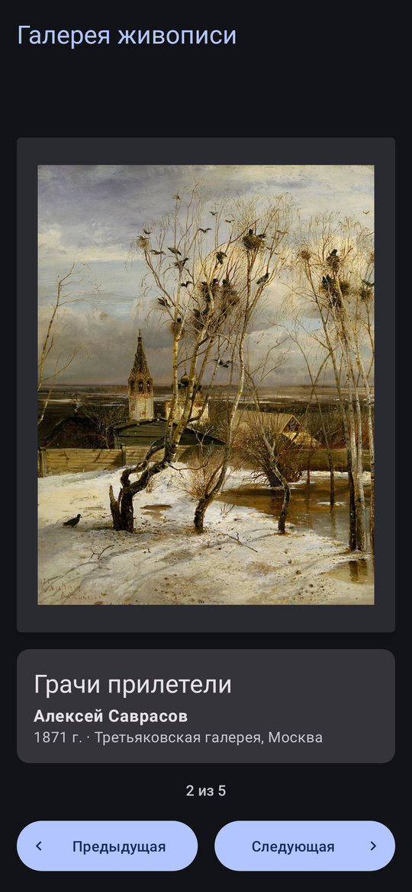
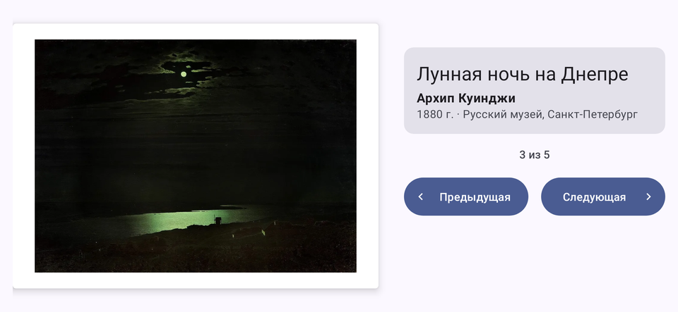

# Art Space — галерея живописи

Лабораторная работа № 2 «Art Space»: приложение показывает пять картин русских художников XIX века и листает их кнопками «Предыдущая» и «Следующая». Разметка на XML.

## Что сделано

- Картина в рамке по центру экрана, под ней название, автор, год и музей. Рамка подстраивается под пропорции картины, поэтому и горизонтальные, и вертикальная работы занимают всё доступное место.
- Коллекция задана данными: `data class Artwork` и список `ArtworkDataSource.artworks` (`List<Artwork>`) с идентификаторами ресурсов, строки — только в `strings.xml`.
- На первой картине кнопка «Предыдущая» неактивна, на последней — «Следующая».
- Номер текущей картины сохраняется в `onSaveInstanceState()` по ключу-константе и читается из `Bundle` в `onCreate()`. После поворота экрана остаются та же картина, подписи и состояние кнопок.
- Отдельная разметка для альбомной ориентации (`layout-land`): картина слева, описание и кнопки справа. Для планшетов увеличены отступы и шрифты (`values-sw600dp`).
- Интерфейс и описания картин на русском и английском (`values`, `values-en`, `values-ru`).
- Доступность: у картины содержательный `contentDescription`, он меняется вместе с картиной; у кнопок понятные описания для TalkBack.

Логика перелистывания вынесена в класс `ArtworkGallery`, `MainActivity` только показывает текущую картину и обрабатывает нажатия. Тесты `ArtworkGallery` — `gradlew testDebugUnitTest`.

## Картины

Все работы в общественном достоянии, изображения взяты из Wikimedia Commons: «Девятый вал» И. К. Айвазовского (1850), «Грачи прилетели» А. К. Саврасова (1871), «Лунная ночь на Днепре» А. И. Куинджи (1880), «Утро в сосновом лесу» И. И. Шишкина и К. А. Савицкого (1889), «Богатыри» В. М. Васнецова (1898).

## Экраны

| Первая картина | Третья картина | Тёмная тема |
|---|---|---|
|  |  |  |

Альбомная ориентация:

